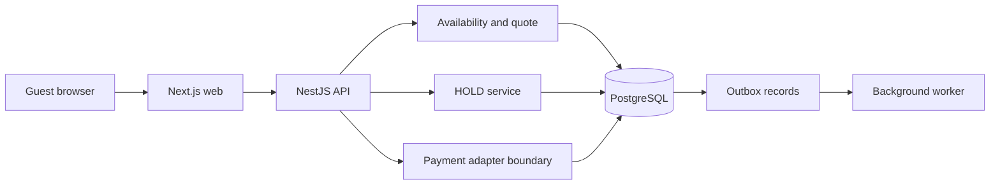

# Booking architecture

**VERIFIED_IMPLEMENTED by source inspection at `32e3b3eb4f8ebbb9d59dc0d7c4b05f32c1d55763`; not a runtime or production assertion.** Diagrams omit client details and operational credentials.



The outbox and worker are represented as implemented components; this diagram does not assert that delivery occurred in a current environment. Relevant source: `apps/api/src/pricing/`, `packages/booking/src/services/create-booking-hold.ts`, `packages/booking/src/repository/booking-repository.ts`, and `apps/worker/`.

```mermaid
sequenceDiagram
  participant Guest
  participant API
  participant DB as PostgreSQL
  Guest->>API: Search room types and interval
  API->>DB: Check active inventory blocks
  API-->>Guest: Available room types
  Guest->>API: Request quote
  API->>DB: Persist server-calculated snapshot
  API-->>Guest: Quote and expiry
  Guest->>API: Request HOLD with quote and contact
  API->>DB: Lock quote; check expiry and inventory
  API->>DB: Transaction: booking, inventory block, audit, outbox
  DB-->>API: Commit or reject conflict
  API-->>Guest: HOLD result or error
```

A quote is not a reservation. Same-quote replay is conditional on equivalent contact, and a changed contact is rejected. Payment is not part of this sequence. See [case study](CASE_STUDY.md) for evidence and limits.
